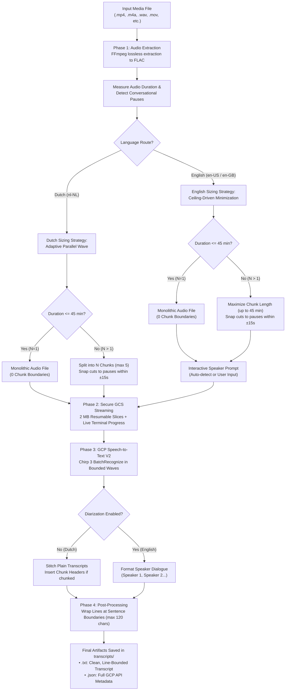

# Marketing Engineers: Transcription Automator v0.2

This project automates the extraction, processing, and transcription of meeting recordings of various formats (e.g., Google Meet `.mp4`, voice memos `.m4a`, etc.) using Python, `ffmpeg`, and Google Cloud Speech-to-Text V2 (Chirp 3).

## Background
There is a huge benefit to having a transcript of your meetings, but we don't like sharing recordings with third parties. Since we have been working with Google Cloud for years, we wanted to build a solution that is secure, private, and cost-effective.

## Data Handling & Privacy

- **Your Cloud, Your Data:** Audio is processed using your own Google Cloud project and uploaded temporarily to your private Google Cloud Storage (GCS) bucket.
- **Automated Cleanup:** Audio chunks uploaded to GCS are automatically deleted in a `finally` execution block upon completion or failure.
- **Bucket Hardening:** We recommend configuring your GCS bucket with Uniform Bucket-Level Access, Public Access Prevention, and a 7-day lifecycle deletion policy.
- **Local Isolation:** Raw media (`input/`), intermediate audio (`output/`), generated transcripts (`transcripts/`), and local logs (`logs/`) are strictly gitignored with built-in pre-commit guardrails to prevent accidental commits of confidential data.

## Prerequisites

- Python 3.10+
- `ffmpeg` and `ffprobe` installed on your system and accessible via the command line (e.g., `sudo apt install ffmpeg` or `brew install ffmpeg`).
- `gcloud` CLI installed and configured.

## Setup

1. **Create and activate a virtual environment:**
   ```bash
   python3 -m venv venv
   source venv/bin/activate
   ```

2. **Install dependencies:**
   ```bash
   pip install -r requirements.txt
   ```

3. **Install local pre-commit guardrails:**
   ```bash
   .githooks/install.sh
   ```

4. **Authenticate with Google Cloud:**
   ```bash
   gcloud auth application-default login
   ```
   *Note: Ensure the **Cloud Speech-to-Text API** is enabled in your GCP project. Quota project attribution is managed programmatically via the `.env` configuration file.*

5. **Provision your private GCS Bucket:**
   Create a secure bucket in your chosen region (e.g., `eu`):
   ```bash
   gcloud storage buckets create gs://<your-bucket-name> --location=eu --uniform-bucket-level-access --public-access-prevention
   ```

6. **Configure environment variables:**
   Copy the example file and adjust as needed:
   ```bash
   cp .env.example .env
   ```
   *Note: Ensure you update `GCP_PROJECT_ID` with your actual GCP project ID and `GCS_BUCKET_NAME` with your bucket name.*

   Key environment variables:
   - `TRANSCRIPTION_CONCURRENCY` (Default: `5`): Maximum number of audio chunks submitted and monitored concurrently per wave.
   - `CHUNK_MAX_LENGTH_SECONDS_DUTCH` (Default: `2700` / 45 min): Maximum chunk duration ceiling for Dutch recordings.
   - `CHUNK_MAX_LENGTH_SECONDS_ENGLISH` (Default: `2700` / 45 min): Maximum chunk duration ceiling for English recordings.
   - `CHUNK_MIN_LENGTH_SECONDS` (Default: `600` / 10 min): Minimum chunk floor below which fixed GCP per-request overhead dominates.
   - `CHUNK_SILENCE_SEARCH_WINDOW_SECONDS` (Default: `15`): Maximum search window in seconds to snap chunk cuts to natural pauses.
   - `CHUNK_SILENCE_NOISE_THRESHOLD_DB` (Default: `-30`): Noise threshold in dB for FFmpeg `silencedetect`.
   - `CHUNK_SILENCE_MIN_DURATION_SECONDS` (Default: `0.5`): Minimum pause duration in seconds to qualify as a cut point.
   - `GCS_UPLOAD_TIMEOUT_SECONDS` (Default: `600`): Socket/upload timeout in seconds for GCS audio uploads.
   - `TRANSCRIPTION_MAX_TIMEOUT_SECONDS` (Default: `1800`): Base maximum timeout cap; dynamically scales with total audio duration for long recordings.
   - `TRANSCRIPTION_MAX_CHARS_PER_LINE` (Default: `120`): Target maximum line length for transcript post-processing.
   - `TRANSCRIPTION_MAX_SENTENCES_PER_LINE` (Default: `3`): Target maximum sentences per line.
   - `TRANSCRIPTION_CUSTOM_PROMPT` (Optional): Custom prompt instruction passed to Chirp 3 models via `CustomPromptConfig`.

## Usage

1. Place your input media file in a directory (e.g., `input/meeting.mp4`).

2. Run the script via the CLI, specifying the input file and the language route:
   ```bash
   python -m src.main input/meeting.mp4 --lang en-US
   ```

3. **Interactive Prompt:** If processing an English recording (which supports diarization), the script will prompt you for the number of speakers:
   ```text
   How many speakers were in this recording? (press Enter to auto-detect):
   ```
   You can enter a number (e.g., `2`) or press Enter to let the Chirp 3 model auto-detect the speaker count.

4. The pipeline will automatically upload the audio to your GCS bucket (`gs://<your-bucket-name>`), run the transcription via BatchRecognize, download the results, and clean up the GCS bucket.

5. **Output:** The final transcripts will be saved in the `transcripts/` directory as both a human-readable text file and a raw JSON API response.
   Transcripts are automatically post-processed at sentence boundaries (`.`, `?`, `!`) to guarantee clean, line-bounded plain text (capped by default at 120 characters per line) for optimal compatibility with CLI tools, git diffs, and LLM contexts.

### Process Flow & Architecture

The following diagram illustrates how the automator evaluates audio recordings, determines chunking strategies and speaker diarization, uploads media to Google Cloud, and formats output transcripts:



#### Functional Step Breakdown

1. **Audio Extraction & Normalization (FFmpeg):**
   - Extracts audio from compressed video or voice recording containers (`.mp4`, `.m4a`, `.mov`, `.wav`) and transcodes losslessly to FLAC.
   - FLAC provides standardized, uncompressed headers that allow Google Cloud to auto-detect sample rates and channel layouts without manual audio declaration.

2. **Intelligent Language Routing & Chunk Sizing:**
   - **Dutch (`nl-NL`) — Parallel Speed Optimization:** Diarization is not supported on Chirp 3 for Dutch, meaning chunk boundaries carry zero speaker-label penalty. Long files are split into up to 5 balanced chunks (`N = TRANSCRIPTION_CONCURRENCY`, minimum 10 min per chunk) so the entire recording transcribes concurrently in a single parallel wave in under ~2–3 minutes.
   - **English (`en-US` / `en-GB`) — Boundary Minimization:** Speaker diarization is supported, but speaker IDs reset across chunk cuts. The pipeline maximizes chunk duration up to the 45-minute API ceiling (`CHUNK_MAX_LENGTH_SECONDS_ENGLISH=2700`) to keep long meetings in as few chunks as possible (e.g. a 90-minute meeting becomes just 2 chunks).
   - **Silence Detection & Snapping:** Instead of cutting audio mid-sentence or mid-word, FFmpeg `silencedetect` locates natural conversational pauses (≥ 0.5s) within a `±15s` window around nominal cut points, ensuring conversational context remains unbroken.
   - **Monolithic Route for Short Recordings:** Any recording ≤ 45 minutes bypasses chunking entirely and processes as a single monolithic FLAC.

3. **Secure Cloud Streaming with Real-Time Feedback:**
   - Audio is uploaded to your private GCS bucket configured with 7-day retention and public access prevention.
   - Uploads stream in 2 MB resumable chunks with live in-place terminal updates (like `wget`/`curl`) and clean, timestamped logs in `logs/app.log`.

4. **Speech-to-Text V2 Batch Transcription:**
   - Submits single-file BatchRecognize requests to Google Cloud Speech-to-Text V2 using Chirp 3.
   - Uses adaptive polling intervals and automated exponential backoff on transient rate limits (`429 RESOURCE_EXHAUSTED`).

5. **Post-Processing & Formatting:**
   - English transcripts format dialogues by speaker (e.g., `Speaker 1: ...`, `Speaker 2: ...`).
   - All transcripts are formatted across sentence boundaries (`.`, `?`, `!`) with a target line length of 120 characters, avoiding thousands of characters on a single line and optimizing for LLMs, diffs, and reading.

---

### Real-Time Upload Feedback & Dual Logging Architecture
- **GCS Upload Streaming:** Large audio chunks are streamed to GCS in 2 MB resumable chunks. When running in an interactive terminal, upload progress updates in place on a single line (like `wget`/`curl`) every 5 seconds, displaying transferred megabytes, percentage, and real-time upload speed (MB/s).
- **Dual Logging (`TerminalProgressHandler` + `CleanFileFormatter`):** The terminal receives dynamic in-place updates and multi-line ASCII progress matrices during transcription. Concurrently, `logs/app.log` and `logs/gcp_api.log` receive clean, formal, single-line entries without terminal escape sequences or multi-line art blocks.

### Bounded Concurrency & Adaptive Polling
Multi-chunk requests are submitted in bounded waves (controlled by `TRANSCRIPTION_CONCURRENCY`, default: 5) with 1-second submission spacing. Operation polling uses adaptive pre-delays and intervals scaled to expected chunk duration, with automated retry on transient `429 RESOURCE_EXHAUSTED` errors to prevent regional queue congestion and API throttling.

### Transcribing Existing GCS Files (`--from-gcs`)
If audio chunks are already uploaded to Google Cloud Storage (e.g. following a recovery or re-run scenario), you can process them directly without local re-encoding or re-uploading:

```bash
# Using the main entrypoint
python -m src.main --from-gcs sample-meeting-2026-08-20_20260820_152628 --lang nl-NL

# Or with full gs:// URI
python -m src.main --from-gcs gs://your-transcriber-bucket/sample-meeting-2026-08-20_20260820_152628 --lang nl-NL

# Or using the dedicated module
python -m src.transcribe_gcs sample-meeting-2026-08-20_20260820_152628 --lang nl-NL
```
The GCS re-transcription workflow automatically discovers and sorts all audio chunks under the prefix, executes the bounded concurrency pipeline, stitches the transcripts, and saves output to `transcripts/`.

### Partial Run (v0.1 Behavior)
If you only want to extract and chunk the FLAC files without calling the GCP API, use the `--prepare-only` flag:
```bash
python -m src.main input/meeting.mp4 --lang en-US --prepare-only
```
You can then manually upload the generated FLACs from the `output/` directory.

### Language Routes

The behavior of the script changes based on the language requested, to accommodate Google Cloud's Chirp 3 model constraints.

#### Dutch (`--lang nl-NL`)
- **Behavior:** Transcribes without diarization (as Chirp 3 does not support diarization for Dutch).
- **Adaptive Parallel Wave:** Sizing optimizes purely for parallel wall-clock completion in one wave (`N = TRANSCRIPTION_CONCURRENCY`), floored at `CHUNK_MIN_LENGTH_SECONDS` (10 min) and capped at `CHUNK_MAX_LENGTH_SECONDS_DUTCH` (45 min).
- **Silence Snapping:** Boundaries snap to natural pauses via FFmpeg `silencedetect` within a `±15s` window.
- **Monolithic Path:** Short recordings (≤ 45 min) naturally process as a single monolithic FLAC with zero chunk cuts.

#### English (`--lang en-US` or `--lang en-GB`)
- **Behavior:** Transcribes with speaker diarization.
- **Ceiling-Driven Boundary Minimization:** Maximizes chunk duration up to the ceiling (`CHUNK_MAX_LENGTH_SECONDS_ENGLISH=2700`, 45 min) to minimize speaker ID fragmentation across chunk cuts.
- **Silence Snapping:** Boundaries snap to natural pauses within `±15s`.
- **Monolithic Path:** Short recordings (≤ 45 min) process monolithically without boundaries.

## Project Structure

```
.
├── .env.example          # Template for environment variables
├── .githooks/            # Pre-commit security and confidentiality guard
├── .gitignore
├── CONTRIBUTING.md       # Contribution guidelines and workflow
├── LICENSE               # MIT License
├── pyproject.toml        # Project metadata and configuration
├── README.md
├── requirements.txt      # Python dependencies
├── SECURITY.md           # Security disclosure policy
├── input/                # (Optional) Drop raw media files here
├── output/               # Intermediate FLAC files appear here
├── transcripts/          # Final generated transcripts
├── logs/                 # Rotating logs (app.log and gcp_api.log)
├── tests/                # Unit and integration test suite
│   ├── test_audio.py
│   ├── test_config.py
│   ├── test_gcs.py
│   ├── test_logger.py
│   ├── test_main.py
│   ├── test_transcribe.py
│   ├── test_transcribe_gcs.py
│   └── test_transcript_output.py
└── src/
    ├── audio.py           # FFmpeg subprocess logic & silence-aware chunking
    ├── config.py          # Environment configuration & migration guard
    ├── gcs.py             # Google Cloud Storage operations & progress reader
    ├── logger.py          # Dual logging architecture (TTY in-place & clean file logs)
    ├── main.py            # CLI entry point and orchestration
    ├── transcribe.py      # Speech-to-Text V2 BatchRecognize logic
    ├── transcribe_gcs.py  # Direct GCS audio transcription & recovery
    └── transcript_output.py # Transcript formatting and stitching
```

## Roadmap & Future Scope (v0.3+)

- **Cross-Chunk Speaker Reconciliation (`gemini-3.6-flash`)**:
  - Pass GCS audio chunk URIs directly to `gemini-3.6-flash` via Vertex AI / Google GenAI SDK to analyze cross-chunk vocal profiles.
  - Automatically generate a `GlobalSpeakerMap` JSON to align speaker labels (`Speaker 1`, `Speaker 2`) across long, multi-chunk recordings without local PyTorch dependencies.
- **Automatic LLM Summarization Pipeline**: Summarize stitched transcripts natively via Gemini.
- **Denoiser Toggle**: FFmpeg noise reduction for phone recordings.
- **Model Adaptation**: Domain-specific vocabulary hints.

## License

This project is licensed under the MIT License - see the [LICENSE](LICENSE) file for details.
