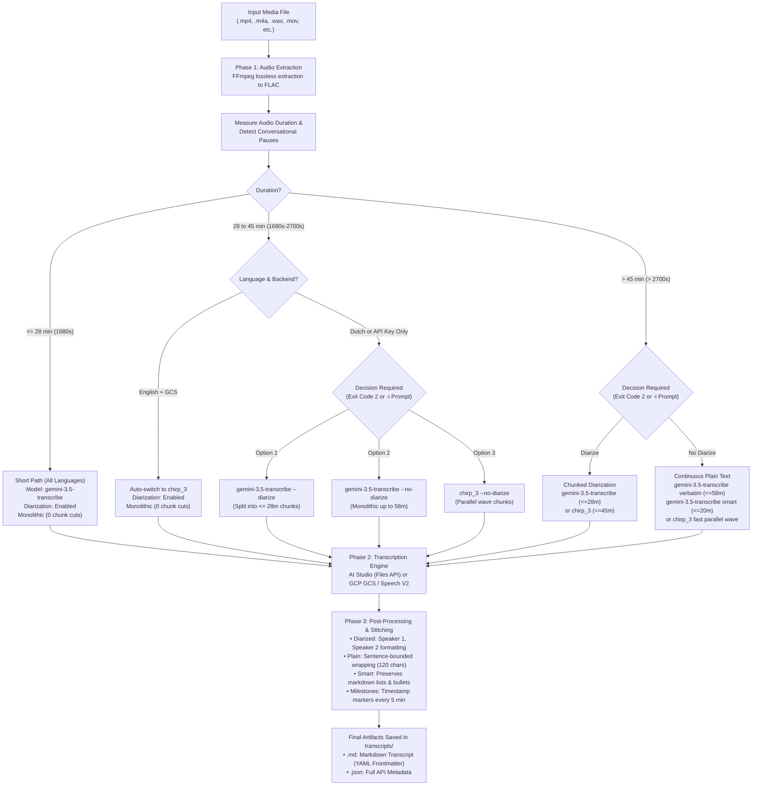

# Google Cloud Meeting Transcriber

## Introduction

There is a huge benefit to having a transcript of your meetings, but we don't like sharing recordings with third parties. Since we have been working with Google Cloud for years, we wanted to build a solution that is secure, private, and cost-effective.

This project automates the extraction, processing, and transcription of meeting recordings of various formats (e.g., Google Meet `.mp4`, voice memos `.m4a`, etc.) using Python, `ffmpeg`, and Google Cloud AI models: Google Cloud Speech-to-Text V2 (Chirp 3) and Gemini 3.5 Transcribe (`gemini-3.5-transcribe`).

### Data Handling & Privacy
- **Your Cloud, Your Data:** Audio is processed using your own Google AI Studio key or your private Google Cloud Storage (GCS) bucket.
- **Automated Cleanup:** Audio chunks uploaded to Gemini Files API or GCS are automatically deleted in a `finally` execution block upon completion or failure.
- **Bucket Hardening:** We recommend configuring your GCS bucket with Uniform Bucket-Level Access, Public Access Prevention, and a 7-day lifecycle deletion policy.
- **Local Isolation:** Raw media (`input/`), intermediate audio (`output/`), generated transcripts (`transcripts/`), and local logs (`logs/`) are strictly gitignored with built-in pre-commit guardrails to prevent accidental commits of confidential data.

---

## Sample Transcript Output

Transcripts are delivered as clean, ready-to-read Markdown files (`transcripts/<basename>_<lang>_transcript.md`) complete with structured YAML frontmatter, speaker identification, and time milestones:

```markdown
---
generated_at: "2026-11-08T16:48:00Z"
source_file: "quarterly_review.mp4"
duration: "18m 30s"
duration_seconds: 1110.0
repository: "marketing-engineers-gcp-audio-transcribe"
settings:
  model: "gemini-3.5-transcribe"
  mode: "verbatim"
  language: "en-US"
  languages:
    - "en-US"
  diarization: true
  speakers: 2
---

# Transcript: quarterly_review.mp4

Speaker 1: Good morning everyone, welcome to the quarterly business review. Today we will walk through our performance and key metrics from Q3.
Speaker 2: Thanks. Let's start by looking at our revenue numbers and customer acquisition channels.

_**[05:00]**_

Speaker 1: Looking at customer acquisition cost, we observed an eighteen percent reduction compared to the previous quarter.
Speaker 2: That's right, primarily driven by strong organic search performance and our new partner referral program.

_**[10:00]**_

Speaker 1: Next up is our product roadmap for the upcoming quarter, specifically our cloud data pipeline initiatives.
Speaker 2: We have allocated dedicated engineering capacity to optimize our real-time streaming pipelines and AI models.

_**[15:00]**_

Speaker 1: Excellent. Let's open the floor for any final questions before we wrap up today's session.
```

*(Note: For long recordings split into multiple chunks, section headers like `## Part A (Chunk 1 of 2)` and `## Part B (Chunk 2 of 2)` are automatically included with a notice that speaker labels reset per chunk).*

---

## Prerequisites

- Python 3.10+
- `ffmpeg` and `ffprobe` installed on your system and accessible via the command line (e.g., `sudo apt install ffmpeg` or `brew install ffmpeg`).
- `gcloud` CLI (optional; only needed if authenticating via workstation Application Default Credentials / ADC, not needed for service account keys or Gemini API keys).

> **Note on GCP APIs:**
> - If using Chirp 3: ensure `speech.googleapis.com` is enabled in your GCP project.
> - If using Vertex AI (`GEMINI_BACKEND=vertex` or `auto`): ensure `aiplatform.googleapis.com` is enabled and your principal has `aiplatform.endpoints.predict` (`roles/aiplatform.user`).
> - If you receive `403 PERMISSION_DENIED (SERVICE_DISABLED)`, run `gcloud services enable aiplatform.googleapis.com speech.googleapis.com`, or switch to `GEMINI_BACKEND=api_key` with a `GEMINI_API_KEY` from Google AI Studio.

---

## Quickstart

Get started in 2 minutes with no GCP project or cloud bucket needed:

1. Obtain an API key from [Google AI Studio](https://aistudio.google.com/).
2. Copy the template and add your key to `.env`:
   ```bash
   cp .env.example .env
   # Add your key to .env:
   # GEMINI_API_KEY=AIzaSy...
   ```
3. Run transcription:
   ```bash
   python -m src.main input/meeting.mp4 --lang en-US
   ```

---

## Full Setup

1. **Create and activate a virtual environment:**
   ```bash
   python3 -m venv venv
   source venv/bin/activate
   ```

2. **Install dependencies:**
   ```bash
   pip install -r requirements.txt
   ```

3. **Install local pre-commit guardrails:**
   ```bash
   .githooks/install.sh
   ```

4. **Authentication Modes:**
   Choose the authentication approach that fits your workflow:
   - **ADC** is great for local development on your own machine.
   - **Service Accounts** are ideal for automated, larger-scale, server/VPS, or autonomous agent deployments.
   - **Gemini API Keys** provide the quickest zero-GCP setup.

   1. **Gemini API Key (Google AI Studio — Zero-GCP):**
      Fastest way to get started. No GCP project or GCS bucket required. Set `GEMINI_API_KEY=your_key` in `.env`. Audio files are uploaded via the Gemini Files API and purged automatically immediately after transcription.
   2. **Application Default Credentials / ADC (Local Workstations):**
      Great for local usage on your own developer machine. Authenticate directly via your personal user account:
      ```bash
      gcloud auth application-default login
      ```
      With `GCP_AUTH_MODE=adc`, the application uses your user credentials to access GCS, Vertex AI, and Speech-to-Text V2.
   3. **Service Account Key (Automated & Agentic Deployments):**
      Great for larger scale, server/VPS deployments, CI/CD pipelines, or autonomous agent platforms (e.g., Hermes). Configure `GCP_AUTH_MODE=service_account_key` and set `GCP_SERVICE_ACCOUNT_KEY_FILE` with a dedicated, least-privilege service account JSON key file (`chmod 600`). See the [Hermes Deployment Guide](docs/hermes-deployment.md) for full IAM provisioning commands.

   > **Validating Credentials & Permissions:**
   > Verify your configuration and bucket access at any time without processing media:
   > ```bash
   > python -m src.main --check-auth
   > ```

5. **Configure environment variables:**
   Copy the example file and adjust as needed:
   ```bash
   cp .env.example .env
   ```

   | Variable | Requirement | Default | Description |
   | :--- | :--- | :--- | :--- |
   | `GEMINI_API_KEY` | **Required** (for AI Studio) | None | Google AI Studio API key (used for zero-GCP setup). |
   | `GCP_PROJECT_ID` | **Required** (for GCP) | None | Google Cloud Project ID (for Vertex AI and Chirp 3). |
   | `GCS_BUCKET_NAME` | **Required** (for GCP) | None | GCS bucket name for audio uploads (Vertex AI and Chirp 3). |
   | `GCP_SERVICE_ACCOUNT_KEY_FILE` | **Required** (for SA mode) | None | Path to service account JSON key (when `GCP_AUTH_MODE=service_account_key`). |
   | `GCP_AUTH_MODE` | Optional | `adc` | GCP auth mode: `adc` (workstation login) or `service_account_key`. |
   | `TRANSCRIPTION_MODEL` | Optional | `auto` | Preferred model: `auto`, `gemini-3.5-transcribe`, or `chirp_3`. |
   | `GEMINI_BACKEND` | Optional | `auto` | Backend for Gemini: `auto`, `api_key` (AI Studio), or `vertex` (GCP). |
   | `GCP_REGION` | Optional | `eu` | GCP region for Speech V2 and Vertex AI endpoints. |
   | `TRANSCRIPTION_CONCURRENCY` | Optional | `5` | Maximum audio chunks submitted concurrently in parallel waves. |
   | `TRANSCRIPTION_MILESTONE_INTERVAL_SECONDS` | Optional | `300` (5 min) | Interval in seconds between transcript milestone markers (`0` disables). |
   | `CHUNK_MAX_LENGTH_SECONDS_GEMINI_DIARIZED` | Optional | `1680` (28 min) | Maximum chunk duration ceiling for Gemini with speaker diarization. |
   | `CHUNK_MAX_LENGTH_SECONDS_DUTCH` | Optional | `2700` (45 min) | Maximum chunk duration ceiling for Chirp 3 Dutch. |
   | `CHUNK_MAX_LENGTH_SECONDS_ENGLISH` | Optional | `2700` (45 min) | Maximum chunk duration ceiling for Chirp 3 English diarized. |
   | `CHUNK_MAX_LENGTH_SECONDS_GEMINI_PLAIN` | Optional | `3480` (58 min) | Maximum chunk duration ceiling for Gemini plain verbatim audio. |
   | `CHUNK_MAX_LENGTH_SECONDS_GEMINI_SMART` | Optional | `1200` (20 min) | Maximum chunk duration ceiling for Gemini smart mode (generative clean-up). |

---

## Usage

### Basic Usage
1. Place your input media file in a directory (e.g., `input/meeting.mp4`).
2. Run transcription via the CLI:
   ```bash
   python -m src.main input/meeting.mp4 --lang en-US
   ```

### Interactive Mode (`-i` / `--interactive`)
When running in a terminal, pass `-i` for guided prompts on language, model, or trade-offs:
```bash
python -m src.main input/meeting.mp4 -i
```

### CLI Flags Explained

| Flag | Values / Type | Default | Description |
| :--- | :--- | :--- | :--- |
| `input_file` | File path | None | Path to input media file (`.mp4`, `.m4a`, `.wav`, `.mov`, etc.). |
| `--lang` | `nl-nl`, `en-us`, `en-gb`, `auto` | None (prompts if `-i`) | Recording language. `auto` enables dynamic detection in Gemini. |
| `-i`, `--interactive` | Flag | `False` | Enables interactive terminal prompts for language and model trade-offs. |
| `--model` | `auto`, `gemini-3.5-transcribe`, `chirp_3` | From `TRANSCRIPTION_MODEL` | Select or force a specific transcription model. |
| `--diarize` | Flag | Auto-resolved | Force enable speaker diarization (`Speaker 1:`, `Speaker 2:`). |
| `--no-diarize` | Flag | Auto-resolved | Force disable speaker diarization (plain continuous text). |
| `--mode` | `verbatim`, `smart` | `verbatim` | Transcription mode for Gemini (`smart` removes disfluencies, formats markdown). |
| `--speakers` | Integer | Auto-detect | Optional speaker count hint for diarization. |
| `--milestone-interval` | Integer (seconds) | `300` (5 min) | Interval between timestamp milestone indicators (`_**[05:00]**_`, `0` disables). |
| `--prepare-only` | Flag | `False` | Extract and chunk FLAC files locally without sending cloud API calls. |
| `--from-gcs` | GCS prefix / URI | None | Transcribe audio files already residing in Google Cloud Storage. |
| `--check-auth` | Flag | `False` | Verify authentication credentials and bucket permissions, then exit. |

### Agent-Friendly Non-Interactive Mode (Exit Code 2)
In non-interactive environments (CI, autonomous agents), if a recording exceeds single-pass limits without explicit `--diarize`/`--no-diarize` flags, the automator exits with exit code `2` (`EXIT_DECISION_REQUIRED`) and emits a structured JSON block describing the options and exact CLI commands.

### Transcribing Existing GCS Files (`--from-gcs`)
If audio chunks are already uploaded to Google Cloud Storage (e.g. following a recovery or re-run scenario), you can process them directly without local re-encoding or re-uploading:
```bash
# Using the main entrypoint
python -m src.main --from-gcs sample-meeting-2026-08-20_20260820_152628 --lang en-US

# Or with full gs:// URI
python -m src.main --from-gcs gs://your-transcriber-bucket/sample-meeting-2026-08-20_20260820_152628 --lang en-US

# Or using the dedicated module
python -m src.transcribe_gcs sample-meeting-2026-08-20_20260820_152628 --lang en-US
```

### Partial Run (`--prepare-only`)
If you only want to extract and chunk the FLAC files without calling the GCP API, use the `--prepare-only` flag:
```bash
python -m src.main input/meeting.mp4 --lang en-US --prepare-only
```

---

## Architecture

### Process Flow



### Functional Step Breakdown

1. **Audio Extraction & Normalization (FFmpeg):**
   - Extracts audio from compressed video or voice recording containers (`.mp4`, `.m4a`, `.mov`, `.wav`) and transcodes losslessly to FLAC.
   - FLAC provides standardized, uncompressed headers that allow Google Cloud to auto-detect sample rates and channel layouts without manual audio declaration.

2. **Intelligent Language Routing & Chunk Sizing:**
   - **Dutch (`nl-NL`) — Parallel Speed Optimization:** Diarization is not supported on Chirp 3 for Dutch, meaning chunk boundaries carry zero speaker-label penalty. Long files are split into up to 5 balanced chunks (`N = TRANSCRIPTION_CONCURRENCY`, minimum 10 min per chunk) so the entire recording transcribes concurrently in a single parallel wave in under ~2–3 minutes.
   - **English (`en-US` / `en-GB`) — Boundary Minimization:** Speaker diarization is supported, but speaker IDs reset across chunk cuts. The pipeline maximizes chunk duration up to the 45-minute API ceiling (`CHUNK_MAX_LENGTH_SECONDS_ENGLISH=2700`) to keep long meetings in as few chunks as possible (e.g. a 90-minute meeting becomes just 2 chunks).
   - **Silence Detection & Snapping:** Instead of cutting audio mid-sentence or mid-word, FFmpeg `silencedetect` locates natural conversational pauses (≥ 0.5s) within a `±15s` window around nominal cut points, ensuring conversational context remains unbroken.
   - **Monolithic Route for Short Recordings:** Any recording ≤ 45 minutes bypasses chunking entirely and processes as a single monolithic FLAC.

3. **Secure Cloud Streaming with Real-Time Feedback:**
   - Audio is uploaded to your private GCS bucket configured with 7-day retention and public access prevention.
   - Uploads stream in 2 MB resumable chunks with live in-place terminal updates (like `wget`/`curl`) and clean, timestamped logs in `logs/app.log`.

4. **Speech-to-Text V2 Batch Transcription:**
   - Submits single-file BatchRecognize requests to Google Cloud Speech-to-Text V2 using Chirp 3.
   - Uses adaptive polling intervals and automated exponential backoff on transient rate limits (`429 RESOURCE_EXHAUSTED`).

5. **Markdown Post-Processing, Frontmatter & Milestones:**
   - **YAML Frontmatter:** Every transcript begins with standard YAML frontmatter containing generation timestamp, source filename, human-readable and second-level audio duration, repository name, and exact transcription settings (model, mode, language(s), diarization, speaker count).
   - **Dialogue Formatting:** Speaker turns format cleanly with normalized speaker labels (`Speaker 1: ...`, `Speaker 2: ...`) and wrap onto new lines at sentence boundaries with a target line length of 120 characters.
   - **Milestone Timestamps:** Rather than polluting every line with timestamps, discrete milestone markers (e.g. `_**[05:00]**_`, `_**[10:00]**_`) appear at regular intervals (default: 5 minutes / 300s, configurable via `--milestone-interval`).
   - **Multi-Chunk Boundary Indicators:** When long recordings are split into multiple chunks, each section is distinctly labeled (`## Part A (Chunk 1 of 2)`, `## Part B (Chunk 2 of 2)`) with a clear callout notice informing readers that speaker labels reset per chunk and do not correlate across parts.

### Language Routes & Multilingual Code-Switching
The pipeline automatically handles language-specific routing and code-switching:
- **European Languages (`nl-NL`, `de-DE`, `fr-FR`, etc.):** When transcribed via Gemini 3.5 Transcribe, requests automatically configure `language_codes=[<lang>, "en-US"]`. This ensures English loanwords, acronyms, and technical terminology are preserved without mid-sentence word drops.
- **Dynamic Language Detection (`--lang auto`):** Gemini dynamically identifies spoken languages across utterances without prior specification. If no language is provided in interactive mode, the CLI prompts for confirmation before defaulting to `auto`.
- **Chirp 3 Route Differences:**
  - **Dutch (`nl-NL`):** Transcribes without diarization on Chirp 3, using adaptive parallel waves (`N = TRANSCRIPTION_CONCURRENCY`, 10–45 min per chunk) for fast completion.
  - **English (`en-US` / `en-GB`):** Transcribes with speaker diarization up to the 45-minute ceiling (`CHUNK_MAX_LENGTH_SECONDS_ENGLISH=2700`).

### Uploads & Logging
- **GCS Upload Streaming:** Large audio chunks are streamed to GCS in 2 MB resumable chunks. When running in an interactive terminal, upload progress updates in place on a single line (like `wget`/`curl`) every 5 seconds, displaying transferred megabytes, percentage, and real-time upload speed (MB/s).
- **Dual Logging (`TerminalProgressHandler` + `CleanFileFormatter`):** The terminal receives dynamic in-place updates and multi-line ASCII progress matrices during transcription. Concurrently, `logs/app.log` and `logs/gcp_api.log` receive clean, formal, single-line entries without terminal escape sequences or multi-line art blocks.

### Bounded Concurrency & Adaptive Polling
Multi-chunk requests are submitted in bounded waves (controlled by `TRANSCRIPTION_CONCURRENCY`, default: 5) with 1-second submission spacing. Operation polling uses adaptive pre-delays and intervals scaled to expected chunk duration, with automated retry on transient `429 RESOURCE_EXHAUSTED` errors to prevent regional queue congestion and API throttling.

---

## Project Structure

```
.
├── .env.example          # Template for environment variables
├── .githooks/            # Pre-commit security and confidentiality guard
├── .gitignore
├── CONTRIBUTING.md       # Contribution guidelines and workflow
├── LICENSE               # MIT License
├── pyproject.toml        # Project metadata and configuration
├── README.md
├── requirements.txt      # Python dependencies
├── SECURITY.md           # Security disclosure policy
├── input/                # (Optional) Drop raw media files here
├── output/               # Intermediate FLAC files appear here
├── transcripts/          # Final generated transcripts (.md and .json)
├── logs/                 # Rotating logs (app.log and gcp_api.log)
├── tests/                # Unit and integration test suite
│   ├── test_audio.py
│   ├── test_config.py
│   ├── test_gcs.py
│   ├── test_logger.py
│   ├── test_main.py
│   ├── test_transcribe.py
│   ├── test_transcribe_gcs.py
│   ├── test_transcribe_gemini.py
│   └── test_transcript_output.py
└── src/
    ├── audio.py           # FFmpeg subprocess logic & silence-aware chunking
    ├── config.py          # Environment configuration & migration guard
    ├── gcs.py             # Google Cloud Storage operations & progress reader
    ├── logger.py          # Dual logging architecture (TTY in-place & clean file logs)
    ├── main.py            # CLI entry point and orchestration
    ├── transcribe.py      # Speech-to-Text V2 BatchRecognize logic
    ├── transcribe_gcs.py  # Direct GCS audio transcription & recovery
    ├── transcribe_gemini.py # Gemini 3.5 Transcribe integration
    └── transcript_output.py # Transcript formatting, frontmatter, and stitching
```

---

## Roadmap

- **Cross-Chunk Speaker Reconciliation (`gemini-3.6-flash`)**:
  - Pass GCS audio chunk URIs directly to `gemini-3.6-flash` via Vertex AI / Google GenAI SDK to analyze cross-chunk vocal profiles.
  - Automatically generate a `GlobalSpeakerMap` JSON to align speaker labels (`Speaker 1`, `Speaker 2`) across long, multi-chunk recordings without local PyTorch dependencies.
- **Automatic LLM Summarization Pipeline**: Summarize stitched transcripts natively via Gemini.
- **Denoiser Toggle**: FFmpeg noise reduction for phone recordings.
- **Model Adaptation**: Domain-specific vocabulary hints.

---

## License

This project is licensed under the MIT License - see the [LICENSE](LICENSE) file for details.
